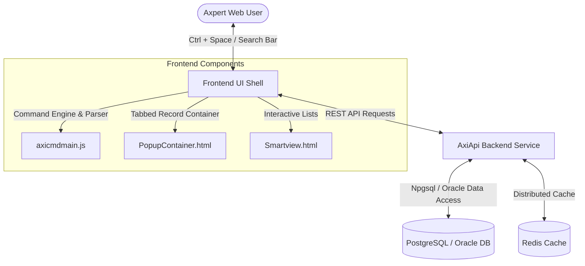
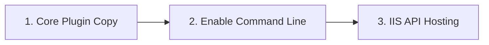

# Axi Command Palette (`AxiCMD`)

The **Axi Command Palette** (`AxiCMD`) is an in-app developer and user command navigation engine designed for the Axpert Web Shell interface. It provides real-time token autocompletion, dynamic transaction routing, multi-entity structure execution (TStructs, IViews, Axpert Data Sources / ADS, Pages, and Inbox), form keyfield management, tabbed record popups, and user favorites.

---

## Architecture Overview

Axi operates across a decoupled three-tier architecture that integrates directly into the Axpert shell:

### 1. Frontend Layer
* **`MainHomeConfigTemplate.html`** (`aspx/`): The product main page template that hosts the command line markup. The separate `AxiCMDMainPage.html` template no longer exists.
* **`axicmdmain.js`**: Core client engine handling input parsing, token resolution, state tracking, suggestion ranking, dynamic command execution, and favorites synchronization.
* **`Smartview.html`**: Interactive list view container supporting dynamic filters, column groupings, and bulk record operations.
* **`PopupContainer.html`**: Tabbed layout engine allowing users to execute and view multiple transaction records concurrently.

### 2. Backend API (`AxiApi`)
* Built on **ASP.NET Core (.NET 8)** with asynchronous request handlers.
* Hosted as an IIS Application inside the ARM microservices environment.
* Manages command configuration retrieval, grammar bootstrapping, user favorites persistence, and form keyfield configuration (`setkeyfield`).
* Features automated database connection retry resilience to protect against transient stream disconnects.

### 3. Database Layer
* Stores command catalog definitions, prompt sequences, user permission mappings, and TStruct property metadata across PostgreSQL and Oracle.
* Scripts located under [`Structures/`](Structures/).

---

## Core Capabilities

* **Dynamic Command Routing (`axi_command_config`):** Eliminates hardcoded transaction IDs and navigation URLs. Commands under `Configure`, `SDK`, `Upload`, and `Download` are dynamically fetched and cached from the database.
* **Form Keyfield Configuration:** Direct execution of `Configure KeyField <TStruct> <Field>` via the backend API (`/api/v1/Axi/setkeyfield`), replacing legacy database stored functions with secure, parameterized SQL.
* **Studio Tool Permissions:** Granular role-based developer option filtering for SDK commands, ensuring core studio tools (`tstruct`, `iview`) remain accessible based on user permissions.
* **Structure Disambiguation:** Resolves entities sharing identical names across TStructs (`[form]`), IViews (`[iview]`), ADS (`[ads]`), Pages (`[page]`), and Inbox with context-aware default rules.
* **User Favorites & Custom Aliasing:** Allows bookmarking frequent commands with custom display aliases and direct iframe deep linking.
* **Session & State Management:** Preserves resolved parameter states across token edits while resetting cleanly on clear button clicks, empty inputs, or refresh.

---

## Database Objects Catalog

The database setup scripts are organized by provider under [`Structures/Postgre/Scripts/`](Structures/Postgre/Scripts/) and [`Structures/Oracle/Scripts/`](Structures/Oracle/Scripts/). Keep the two sets in sync when you change either one.

### Core Tables

| Table | Purpose |
| :--- | :--- |
| `axi_command_config` | Dynamic routing rules, target prompt IDs, option types (`tstruct`, `iview`, `action`, `url`), and active status flags. |
| `axi_commands` | Root command verbs, aliases, and active statuses. |
| `axi_command_prompts` | Dynamic autocomplete prompt fields, positional order, and data sources. |
| `axp_tstructprops` | TStruct property definitions and primary key field configurations (`keyfield`, `userconfigured`). |
| `axi_userfavourites` | User-defined command shortcuts, custom alias labels, and target URLs. |
| `axdirectsql_metadata` | Cached metadata and field captions for Direct SQL / ADS queries. |

### Core Stored Procedures & Functions

* **`fn_axi_getstructures_meta`**: Returns metadata for all TStructs, IViews, Pages, and ADS structures accessible to the current user.
* **`fn_axi_getstructs_obj`**: Dynamically queries records from a target structure with permission and row-level dimension filtering.
* **`fn_permissions_getpermission`**: Validates user access rights (`Create`, `View`, `Edit`) for transaction IDs (`transid`).

---

## Deployment & Setup

### 1. Core Files Placement
1. Install or copy the `AxiCMD` plugin folder into `/AxpertPlugins/AxiCMD/`.
2. The command line markup is part of the product main page template, `aspx/MainHomeConfigTemplate.html`. No separate template file needs to be copied or selected.

> [!IMPORTANT]
> `AxiCMDMainPage.html` and `AxiCMDMainTemplate.html` must **not** exist in `AxpertPlugins/AxiCMD/`, in `AxpertWeb/AxpertPlugins/AxiCMD/HTMLPages/`, or in `AxpertWeb/CustomPages/`. Remove any old copies when you upgrade.

### 2. Enable the Command Line
The command line is **hidden by default**. A flag named `axicmdEnabled` on the MainNew page controls whether it is shown. Set it with this Developer Option:

| Setting | Value |
| :--- | :--- |
| Property | **Axi Command Line Enable** |
| Property Code | `General` |
| Value | `true` / `false` (default `false`) |
| User Role | All, or a single role |

1. Log in to **AxpertWeb** $\rightarrow$ Navigate to **Dev Options**.
2. Set **Axi Command Line Enable** to `true` for the roles that should see it.
3. Set it to `false` to hide the command line again.

### 3. IIS Backend API (`AxiCMDApi`) Hosting
1. Publish and copy `AxiCMDApi` into your target **Arm microservices** directory.
2. In IIS Manager, create an Application Pool named `AxiCMDApi` set to **No Managed Code**.
3. Create a new IIS Application pointing to the `AxiCMDApi` directory under the default website.
4. Ensure `appsettings.ini` is present in the parent microservices folder to supply database connection credentials.
5. Grant **Read & Write** file permissions to the IIS Application Pool identity (`IIS_IUSRS`).

---

## Key Files Reference

* [`HTMLPages/js/axicmdmain.js`](HTMLPages/js/axicmdmain.js): Command palette core JavaScript engine.
* [`AxiCMDVersioninfo.json`](AxiCMDVersioninfo.json): Version tracker manifest (currently `v1.0.0`).
* [`aspx/MainHomeConfigTemplate.html`](../../aspx/MainHomeConfigTemplate.html): Product main page template that hosts the command line.
* [`HTMLPages/Smartview.html`](HTMLPages/Smartview.html): Dynamic list view engine for ADS and IViews.
* [`HTMLPages/PopupContainer.html`](HTMLPages/PopupContainer.html): Multi-tab popup window manager.
* [`docs/DOCUMENTATION.md`](docs/DOCUMENTATION.md): Detailed technical & developer guide.
* [`docs/DYNAMIC_COMMAND_CONFIG_USER_GUIDE.md`](docs/DYNAMIC_COMMAND_CONFIG_USER_GUIDE.md): User guide for dynamic command configuration.

---

## Release Notes

### v1.0.0

* Renamed **Axi_Beta** to **AxiCMD**, and **AxiApi_Beta** to **AxiCMDApi**.
* Moved the AxiCMD HTML into `MainHomeConfigTemplate.html` and removed the separate `AxiCMDMainPage.html` template.
* Added the **Axi Command Line Enable** Developer Option and the `axicmdEnabled` flag. The command line is hidden by default.
* The popup container (`PopupContainer.html`) now loads all of its assets locally, with no CDN references.
* Bug fixes: TKT-1301 (ERPDEMO command line issues), TKT-1212 (command line getting stuck), TKT-1214 (input field unresponsive after Backspace).
