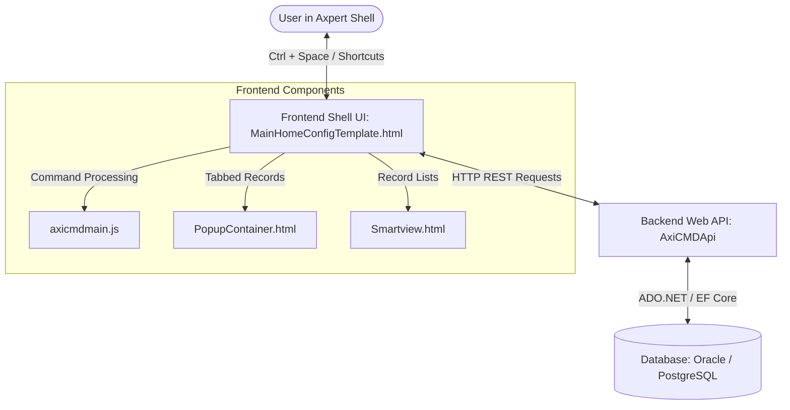

# Axi Command Palette (AxiCMD) | Technical, Architectural & Usage Documentation

Welcome to the comprehensive documentation for the **Axi Command Palette** plugin (`AxiCMD`). This document provides system administrators, database administrators, developers, and end-users with a complete guide to the system's architecture, database schema, APIs, frontend layouts, keyboard shortcuts, installation procedures, and daily usage patterns.

---

## 📌 Table of Contents
1. [System Architecture Overview](#-system-architecture-overview)
2. [Database Schema & Objects](#-database-schema--objects)
    * [Tables Catalog](#tables-catalog)
    * [Stored Procedures & Functions (PostgreSQL vs. Oracle)](#stored-procedures--functions-postgresql-vs-oracle)
3. [Backend API Specifications (AxiCMDApi)](#-backend-api-specifications-axicmdapi)
4. [Frontend Components & User Interface](#-frontend-components--user-interface)
5. [Interactive Keyboard Shortcuts](#-interactive-keyboard-shortcuts)
6. [Supported Command Catalog](#-supported-command-catalog)
7. [Installation & Deployment Steps](#-installation--deployment-steps)
8. [User Usage Guide](#-user-usage-guide)
    * [Activating the Palette](#activating-the-palette)
    * [Constructing Commands with Auto-Complete Hints](#constructing-commands-with-auto-complete-hints)
    * [Pinning Favourites and Recents](#pinning-favourites-and-recents)
    * [Tabbed Window Management (Popup Container)](#tabbed-window-management-popup-container)
    * [Interactive Lists (Smartview)](#interactive-lists-smartview)
    * [Visual Dashboards (Analytics)](#visual-dashboards-analytics)
9. [Developer/Administrator Configuration Guide](#-developeradministrator-configuration-guide)
    * [Adding Custom Commands](#adding-custom-commands)
    * [Registering Auto-Complete Prompts](#registering-auto-complete-prompts)
    * [Direct SQL Metadata Generation](#direct-sql-metadata-generation)
10. [Troubleshooting & Maintenance](#-troubleshooting--maintenance)

---

## 🏗 System Architecture Overview

The Axi Command Palette is designed as a modular, high-performance command-driven search and navigation utility that integrates directly into the Axpert Web Shell interface. The architecture is split into three main layers:



### 1. Frontend Layer
*   **MainHomeConfigTemplate.html** ([aspx/MainHomeConfigTemplate.html](../../../aspx/MainHomeConfigTemplate.html)): The product main page template. It contains the command line markup (`DvAxiCMD`) and loads `axicmdmain.js` and `axicmdmain.css` only when the command line is enabled. The former separate template, `AxiCMDMainPage.html`, no longer exists.
*   **axicmdmain.js** ([axicmdmain.js](../HTMLPages/js/axicmdmain.js)): Contains the main autocomplete suggestion logic, command parser, state machine, and API client.
*   **Smartview.html** ([Smartview.html](../HTMLPages/Smartview.html)): Handles interactive record list views, filtering, utility actions, and multi-select deletion.
*   **PopupContainer.html** ([PopupContainer.html](../HTMLPages/PopupContainer.html)): Provides a tabbed interface to manage multiple open transactions in parallel. All of its assets (Bootstrap and icon styles, jQuery, jQuery UI, html2canvas) are served locally; it makes no CDN requests.


### 2. Backend API Layer (`AxiCMDApi`)
*   Built on **.NET 8.0** for high performance and native async request processing.
*   Acts as a microservice running under IIS (or stand-alone).
*   Resolves database connection settings from the shared `appsettings.ini` file in the parent Arm microservices directory.
*   Supports both **PostgreSQL** (`Npgsql`) and **Oracle** (`Oracle.ManagedDataAccess`) data providers.

### 3. Database Layer
*   Maintains configurations for commands and dynamic parameter prompts.
*   Implements security and permission queries to filter search suggestions based on the logged-in user's roles and responsibilities.

---

## 🗄 Database Schema & Objects

The database schema scripts are located under the [Structures](../Structures/) directory.

### Tables Catalog

The following tables define the command structure and properties:

| Table Name | Description | Key Columns |
| :--- | :--- | :--- |
| `axi_commands` | Stores root command words and their groupings. | `cmdtoken` (PK), `command_group`, `command`, `active` |
| `axi_command_prompts` | Stores prompt inputs, token positions, dynamic sources, and URL parameters for auto-complete suggestions and traditional commands (`Create`, `Edit`, `View`, `SDK TStruct`, `SDK IView`). | `id` (PK), `cmdtoken`, `wordpos`, `prompt`, `promptsource`, `promptvalues`, `extraparams` |
| `axi_command_config` | Stores dynamic command navigation mappings, target URLs, and parameter field definitions for `Configure`, standard `SDK` options, `Upload`, and `Download`. | `config_id` (PK), `command`, `prompt_options`, `prompt_id`, `prompt_option_type`, `param_field`, `target_url`, `extra_params`, `active` |
| `axp_tstructprops` | Manages additional properties for Tstruct definitions (e.g., custom primary key fields). | `name`, `caption`, `keyfield`, `userconfigured` |
| `axdirectsql_metadata` | Caches column names and metadata details for direct SQL queries (`ADS`). | `axdirectsql_metadataid` (PK), `axdirectsqlid`, `fldname`, `fldcaption` |

### Stored Procedures & Functions (PostgreSQL vs. Oracle)

Depending on the database engine, the structures differ slightly to accommodate platform features:
*   **PostgreSQL Scripts:** [Structures/Postgre/Scripts/](../Structures/Postgre/Scripts/)
*   **Oracle Scripts:** [Structures/Oracle/Scripts/](../Structures/Oracle/Scripts/)

Keep the two sets in sync: any change to a PostgreSQL script needs the matching change in the Oracle script, and the other way round.

#### Core Functions:
1.  **`fn_axi_getstructures_meta`**
    *   **PostgreSQL:** [fn_axi_getstructures_meta](../Structures/Postgre/Scripts/axi_functions.sql)
    *   **Oracle:** Returns a pipelined cursor table type `AXI_GETSTRUCTURES_META_tbl`.
    *   **Purpose:** Aggregates all accessible Tstructs, Iviews, Pages, and Axpert Data Sources (ADS) for the logged-in user. Filters by user responsibility permissions.
2.  **`fn_axi_getstructs_obj`**
    *   **PostgreSQL:** [fn_axi_getstructs_obj](../Structures/Postgre/Scripts/axi_functions.sql)
    *   **Oracle:** Returns a pipelined type `axi_getstructs_obj_tbl`.
    *   **Parameters (10):** `pcmd`, `pusername`, `puserrole`, `ptransid`, `pselectedfield`, `pdimension`, `ppermission`, `pkeyfield`, `pprimarytable`, `pglobalvars`. The `axi_getstructsdata` ADS row passes them as `:param1` to `:param10`, in this order.
    *   **Purpose:** Fetches records from a target Tstruct base table dynamically based on a search value. Evaluates row-level dimension filters and user read-write permissions. When no field is selected (`pselectedfield = '0'`) it returns the record values first (newest first), followed by the field list (`isfield = 't'`).
3.  **`fn_permissions_getpermission`**
    *   **PostgreSQL:** [fn_permissions_getpermission](../Structures/Postgre/Scripts/axi_functions.sql)
    *   **Purpose:** Validates whether the logged-in user is authorized to perform Create, View, or Edit operations on a specific transaction (transid).
4.  **`fn_axi_getkeyvalueswithfieldnameslist`**
    *   **PostgreSQL:** [fn_axi_getkeyvalueswithfieldnameslist](../Structures/Postgre/Scripts/axi_functions.sql)
    *   **Purpose:** Dynamically extracts the primary key values and available column descriptors for a given transaction structure.
5.  **`axi_firesql_v2`**
    *   **PostgreSQL:** [axi_firesql_v2](../Structures/Postgre/Scripts/axi_functions.sql)
    *   **Purpose:** A secure SQL executor that allows parametrized queries to prevent SQL injection vulnerabilities.

> [!NOTE]
> In Oracle environments, SQL procedures return pipelined table sets using custom types like `AXI_GETSTRUCTURES_META` and `axi_getstructs_obj` to achieve maximum compatibility with the .NET Entity Framework Core mapping.

---

## 🔌 Backend API Specifications (AxiCMDApi)

The .NET 8 backend API acts as the bridge. It provides three key endpoints consumed by the frontend javascript client.

### 1. Retrieve Configured Objects & Permissions
*   **Route:** `/api/v1/Axi/axi_get`
*   **Method:** `POST`
*   **Headers:** `Content-Type: application/json`
*   **Response:** A JSON collection of structs, pages, and direct SQL datasets mapped to the user's workspace profile.

### 2. Manage Favorites / Recents
*   **Route:** `/api/v1/Axi/user-favourites`
*   **Method:** `GET` / `POST` / `DELETE`

### 3. Retrieve Dynamic Command Navigation Configuration
*   **Route:** `/api/v1/Axi/command-config`
*   **Method:** `GET`
*   **Query Parameters:**
    *   `appname` (string, required): Target application name.
    *   `username` (string, required): Logged-in username.
    *   `forceRefresh` (boolean, optional): Set `true` to bypass Redis cache and reload directly from database.
*   **Response:** A JSON array of `CommandConfigDTO` objects defining dynamic navigation targets (`tstruct`, `iview`, `url`, `tstruct/iview`, `processflow`, `action`).
*   **Caching Strategy:** Cached in Redis under user-isolated key `axi_<appname>_command_config_<username>`.


---

## 🎨 Frontend Components & User Interface

The frontend code leverages existing Axpert UI style libraries and custom CSS extensions:
1.  **MainHomeConfigTemplate.html** ([aspx/MainHomeConfigTemplate.html](../../../aspx/MainHomeConfigTemplate.html)):
    *   Hosts the search container `<div class="AXI-Sec">` which floats at the top of the interface, inside the `DvAxiCMD` block.
    *   The `DvAxiCMD` block is hidden (`d-none`) by default. It is shown, and `axicmdmain.js` / `axicmdmain.css` are loaded, only when the `axicmdEnabled` flag is true (see [Enabling the Command Line](#step-3-enable-the-command-line)).
    *   Defines modal overlays for confirming deletion of favorites, custom alerts, and dynamic loading states.
2.  **axicmdmain.js** ([axicmdmain.js](../HTMLPages/js/axicmdmain.js)):
    *   Maintains autocomplete logic. It tokenizes user inputs and maps them to the matching command group (e.g., `Create`, `Edit`, `View`, `DevTools`).
    *   Appends dynamic parameter helpers in `axiHint` to instruct users on what parameters (like field values or search strings) are expected next.
3.  **axicmdmain.css** ([axicmdmain.css](../HTMLPages/css/axicmdmain.css)):
    *   Provides clean aesthetics: rounded boundaries, transparent inputs, custom action overlays, and scrollable recommendation list containers.

---

## ⌨️ Interactive Keyboard Shortcuts

Users can operate the command palette entirely via key combinations:

| Keyboard Shortcut | Context / Input Focus | Action Triggered |
| :--- | :--- | :--- |
| **`Ctrl + Space`** | Anywhere in the application | **Toggle Command Palette** (opens or focuses the search input). |
| **`Ctrl + Enter`** | Inside `Axi-Searchinp` | **Run / Execute (Go)** (triggers default action or "goOption", loading the target in the current frame). Supports direct single-target execution. |
| **`Ctrl + S`** | Inside active forms | **Save Record** (automatically commits active structural fields). |
| **`Ctrl + Shift + Enter`** | Inside `Axi-Searchinp` | **Open in Popup (Pop-Up)** (loads the screen within the tabbed `PopupContainer.html` iframe). Supports direct single-target execution. |
| **`Ctrl + Alt + Enter`** | Suggestions selected | **View Command Source / Metadata** (opens underlying schema configuration). |
| **`Backspace`** | After action word | **Command Reset** (erases trailing tokens and parameters safely). |

---

## 📋 Supported Command Catalog

Axi evaluates the command using **Target-First** syntax parser rules, allowing the target structure name to be specified first followed by capability-constrained actions.

### 1. `"[tstruct]" Create`
*   **Description:** Opens a fresh form to create a new transaction record.
*   **Example:** `"Customer Form" Create`

### 2. `"[tstruct]" Edit [search value] with [field name] [value]`
*   **Description:** Navigates directly to an existing transaction record to edit specific fields.
*   **Example:** `"Customer Form" Edit 10452 with Email "john.doe@gmail.com"`

### 3. `"[Tstruct/Iview/Page/ADS]" View [search value]`
*   **Description:** Displays records in read-only view. Works with transaction forms (`Tstruct`), database views (`Iview`), standard web pages (`Page`), or custom direct SQL configurations (`ADS`).
*   **Example:** `"Invoice" View 2099`

### 4. `Configure [type] [name] [key field]`
*   **Description:** Quick access to system configuration settings. Supported types include `Rule`, `KeyField`, `User`, `Role`, `Responsibility`, `Dimension`, `Form Notification`, and `PEG`.
*   **Example:** `Configure User admin`

### 5. `Upload` & `Download`
*   **Description:** Import or export datasets.

### 6. `SDK [type] [name]`
*   **Description:** Opens utility tools. Types include `DB Explorer`, `App Variables`, `Arrange Menu`, `Dev Option`, `Language`, and `Custom Plugin`.
*   **Example:** `SDK DB Explorer`

### 7. `Analyse [entity]` (Deprecated)
*   **Description:** Displays the custom dashboard (`Analytics.html`) showing charts, summary metrics, and KPI graphs for the selected entity. *(Note: This command is deprecated and no longer recommended).*
*   **Example:** `Analyse sales_ledger`

### 8. `Help`
*   **Description:** Launches the interactive onboarding walkthrough tour highlighting search syntax, autocomplete suggestions, direct execution shortcuts, and favorites manager. During the tour, input editing and shell toolbar buttons are disabled to guide the user cleanly.
*   **Example:** `Help`

### 9. `Version`
*   **Description:** Fetches and displays the current plugin release version from the local version file.
*   **Example:** `Version`

---

## ⚙️ Installation & Deployment Steps

Follow this step-by-step pipeline to host and configure the plugin:

### Step 1: Core Package Deployment
1.  Open the **AxInstaller** tool.
2.  Install the **AxiCMD** plugin.
3.  Ensure source files populate correctly under `D:\Axpert11.4\AxpertWebLatest\AxpertPlugins\AxiCMD\`.

### Step 2: Front-End Registration
There is **no separate template to copy**. The command line markup is part of the product main page template, `aspx/MainHomeConfigTemplate.html`, which ships with the product.

> [!IMPORTANT]
> The files `AxiCMDMainPage.html` and `AxiCMDMainTemplate.html` must **not** exist in any of these locations. Delete old copies when you upgrade from an earlier version:
> *   `AxpertPlugins/AxiCMD/` (in git)
> *   `AxpertWeb/AxpertPlugins/AxiCMD/HTMLPages/` (on the server)
> *   `AxpertWeb/CustomPages/` (on the server)

### Step 3: Enable the Command Line
The command line is **hidden by default**. The MainNew page sets a flag named `axicmdEnabled`, and the main page template shows or hides the command line based on it. Control the flag with a Developer Option:

| Setting | Value |
| :--- | :--- |
| Property | **Axi Command Line Enable** |
| Property Code | `General` |
| Value | `true` / `false` (default `false`) |
| User Role | All roles, or a single role |

1.  Log in to the **AxpertWeb** interface as administrator.
2.  Navigate to **Dev Options** and set **Axi Command Line Enable** to `true` for the roles that should see the command line.
3.  Reload the application. Set the value back to `false` to hide the command line again, for example while testing.

### Step 4: IIS Backend Setup (`AxiCMDApi`)
1.  Copy the [AxiCMDApi](../PluginScripts/AxiCMDApi) folder.
2.  Paste it into the **Arm microservices** publication directory on your target IIS server.
3.  Configure a new Application Pool in IIS Manager:
    *   **Name:** `AxiCMDApi`
    *   **.NET CLR Version:** `No Managed Code` (since it uses .NET 8 runtime directly).
4.  Create an application pointing to the `AxiCMDApi` folder.
5.  Copy `appsettings.ini` from `../AxpertWebScript/` and place it in the **Arm microservices** parent directory so the API can read connection strings.
6.  Assign **Read & Write** folder permissions to the App Pool Identity (e.g. `IIS_IUSRS`).

### Step 5: Database Scripts Execution
Execute the appropriate scripts based on your target database:

*   **PostgreSQL:** Run the scripts inside [Structures/Postgre/Scripts/](../Structures/Postgre/Scripts/):
    1.  `axi_axdirectsql_tables.sql`
    2.  `axi_command_tables.sql`
    3.  `axi_command_config.sql`
    4.  `axi_dependent_tables.sql`
    5.  `axi_functions.sql`

*   **Oracle:** Run the scripts inside [Structures/Oracle/Scripts/](../Structures/Oracle/Scripts/):
    1.  `axi_axdirectsql_tables.sql`
    2.  `axi_command_tables.sql`
    3.  `axi_command_config.sql`
    4.  `axi_dependent_tables.sql`
    5.  `axi_functions.sql`

> [!NOTE]
> The Oracle `axi_functions.sql` script drops functions before the types they use (for example `fn_axi_getstructures_meta` before `AXI_GETSTRUCTURES_META_tbl`), so it can be re-run safely. If a re-run still fails with `ORA-02303: cannot drop or replace a type with type or table dependents`, find what depends on the type with `SELECT name, type, referenced_name FROM user_dependencies WHERE referenced_name IN (...)`, drop those objects first, and run the script again.

---

## 📖 User Usage Guide

### Activating the Palette & Help Walkthrough
Type **`help`** (case-insensitive) inside the Axi Command pallete search bar. The palette will automatically convert it to `"Help "` and suggest the next token. Select the action or hit **Enter** to launch the interactive onboarding tour.


### Constructing Commands with Auto-Complete Hints
Axi features a **predictive parameter builder** that dynamically shows context hints inside the search bar as you type using target-first execution flow:

```
Step 1: Type Target name (e.g., "Customer Form"). Auto-quoting encloses multi-word targets in quotes when space is typed.
Step 2: Type/select Action (e.g., "Create"). Suggestions list capability-constrained actions in PascalCase.
Step 3: Press "Ctrl + Enter" (Go) or "Ctrl + Shift + Enter" (Pop-Up) to execute immediately.
```

For structure types `iview`, `i`, `ads`, or `p`/`page`, the default action option list displays `View`, `goOption`, and `popOption` options.

If editing a record:
1.  Type target name `"Customer Form"`.
2.  Type or select action `Edit`.
3.  Type a search value (like a customer ID `10452`). Axi will fetch matching records from the database. Select `John Doe` from the recommendations list.
4.  Type `with`.
5.  Type `Email`. Axi will position the cursor directly onto the Email field of John Doe's customer record for immediate editing.

### Pinning Favourites and Recents
Frequently used commands can be saved for quick execution:
1.  Type any valid command syntax into the input bar and execute it (e.g., `"Invoice" View 2099`).
2.  Click the **Bookmark icon** (`#axiAddFavoriteBtn`) located on the top toolbar, or press the shortcut.
3.  A popup modal will appear prompting you to name this favorite (e.g., "Check Invoice 2099").
4.  **Duplicate Validation:** Before adding, Axi normalizes the entered command name and original command text (case/whitespace-insensitive check). If a duplicate exists, it displays `"This command is already in your Favorites."` and prevents saving.
5.  Type the name and press **Enter** (or click **Save**).
6.  Your favorites list is loaded automatically on startup, populating your saved favorites instantly at the top of the suggestion panel.
7.  **Viewing Favorites:** Click the **View Favorites icon** (`#axiViewFavoritesBtn`) on the toolbar to open the sliding favorites dropdown list.
8.  **Removing a Favorite:** Hover over the favorite command card in the suggestion list and click the **X icon** (Delete) to remove it.

### Tabbed Window Management (Popup Container)
When launching screens from the Command Palette, you can preserve your current shell layout by loading them into a tabbed popup:
1.  Type your command (e.g., `Create customer`).
2.  Press **`Ctrl + Shift + Enter`** (instead of standard `Ctrl + Enter`).
3.  The screen will load in a tab inside the **Popup Container**.
4.  You can open multiple transactions sequentially. Each will open as a separate tab (e.g., "Customer Create", "Invoice 2099", "Sales Chart").
5.  Click on the tabs to switch views instantly. Click the **Close (X) button** on each tab to release the resources.

### Interactive Lists (Smartview)
When searching lists of entities, Axi routes the data into the interactive **Smartview** panel:
*   **Search and Filter:** Use the search bar in the Smartview toolbar to search records, or click the **Tune** icon to open advanced query filters.
*   **Column Customization:** Click the **Services** icon (Utilities) and select **Select Fields**. Check or uncheck columns to customize your data table view.
*   **Batch Action (Delete):** Select multiple records using checkboxes, then click the **Trash/Delete** icon in the toolbar to batch-delete them.


---

## 🛠 Developer/Administrator Configuration Guide

Administrators can customize the commands, parameters, and database bindings.

### Adding Custom Commands
To add a new command group:
1.  Assign a unique `cmdtoken` identifier.
2.  Insert a row into `axi_commands`:
    ```sql
    INSERT INTO axi_commands (cmdtoken, command_group, command, active)
    VALUES (12, 'Publish', '', 'T');
    ```

### Registering Auto-Complete Prompts
To specify what parameter recommendations are shown when the command is typed, insert details into `axi_command_prompts`:
*   `cmdtoken`: Maps to the command group.
*   `wordpos`: The word index location in the typed command where this autocomplete is triggered (1-indexed).
*   `prompt`: Context helper text (e.g., "object name").
*   `promptsource`: The name of the database table, database function, or static list values to load suggestions from.
*   `extraparams`: Parameter mapping bindings (e.g., passing `:username`, `:userrole`, `:transid`).

### Command Configuration Architecture Matrix

Axi uses a dual-table architecture to balance dynamic database-driven navigation with specialized prompt tokenization:

| Command Category / Family | Target Configuration Table | Runtime Execution Mechanism | Notes |
| :--- | :--- | :--- | :--- |
| `Configure` (e.g. `User`, `Role`, `Publish`, `PEG`, `Keyfield`) | `axi_command_config` | Dynamic Dispatcher (`executeDynamicNavigation`) | Driven purely by database rows in `axi_command_config`. |
| Standard `SDK` (e.g. `DB Explorer`, `App Variables`, `Arrange Menu`) | `axi_command_config` | Dynamic Dispatcher (`executeDynamicNavigation`) | Driven purely by database rows in `axi_command_config`. |
| `Upload` & `Download` | `axi_command_config` | Dynamic Dispatcher (`executeDynamicNavigation`) | Driven purely by database rows in `axi_command_config`. |
| **`SDK TStruct` & `SDK IView`** | **`axi_command_prompts`** | Studio Bridge (`handleOpenSource` / `safeOpenDeveloperStudio`) | **Architectural Exception:** Bypasses `axi_command_config` because it launches the embedded React Developer Studio modal rather than an iFrame URL. |
| `Create`, `Edit`, `View`, `Run` | `axi_command_prompts` | Token Resolver & Subsystem Handlers | Driven by `axi_command_prompts` for multi-token auto-complete suggestions. |

> [!IMPORTANT]
> **Architectural Exception — SDK TStruct & SDK IView:**
> `SDK TStruct` and `SDK IView` are explicitly **not** configured in `axi_command_config`. Because they launch the embedded React Developer Studio builder (`safeOpenDeveloperStudio("tstreact")` / `safeOpenDeveloperStudio("ivreact")`) with special "create new" template state rather than navigating to an iFrame URL, they continue to be maintained via `axi_command_prompts` and `handleOpenSource`.

### Configuring Dynamic Commands (`axi_command_config`)

Commands (such as `Configure`, `SDK`, `Upload`, `Download`) can be configured dynamically without writing frontend JavaScript handler code by adding entries to `axi_command_config`:

```sql
INSERT INTO axi_command_config 
(config_id, command, prompt_options, prompt_id, prompt_option_type, param_field, target_url, extra_params, active)
VALUES 
('cfg_configure_publish_listing', 'Configure', 'publish config studio', 'axpub/ad_pbcs', 'tstruct/iview', 'servername', NULL, NULL, 'T');
```

#### Supported `prompt_option_type` Values:
| `prompt_option_type` | Description & Behavior |
| :--- | :--- |
| `tstruct` | Navigates to a TStruct transaction form (`tstruct.aspx`). Appends `param_field` if parameter is provided. |
| `iview` | Navigates to an IView report/listing (`iview.aspx`). |
| `ivtoivload` | Navigates to an IView-to-IView detail loader (`ivtoivload.aspx`). |
| `url` | Navigates to a custom target ASPX page or web URL. |
| `tstruct/iview` / `iview/tstruct` | **Dual Composite Mode:** Opens TStruct edit form when a parameter is provided; opens IView listing when no parameter is provided. |
| `processflow` | **Process Builder Mode:** Opens Process Flow builder (`processflow.aspx?loadcaption=AxProcessBuilder`). Opens blank `ad_pm` form if no parameter is provided. |
| `action` | **Background Action Mode:** Executes non-navigational background API/ADS routines (e.g. `keyfield` via `axi_tstructprops_insupd`). |


---

## 🛠 Troubleshooting & Maintenance

*   **Command Palette is not visible:**
    *   The command line is hidden by default. Check that the **Axi Command Line Enable** Developer Option is set to `true` for the user's role.
    *   Confirm that `AxiCMDMainPage.html` and `AxiCMDMainTemplate.html` do not exist in `AxpertPlugins/AxiCMD/`, `AxpertWeb/AxpertPlugins/AxiCMD/HTMLPages/` or `AxpertWeb/CustomPages/`.
    *   Make sure the search input (`Axi-Searchinp`) is present in the rendered `MainHomeConfigTemplate.html`, and that `axicmdmain.js` and `axicmdmain.css` load without errors in the browser's Network tab.
*   **A script change does not take effect:**
    *   The browser caches `axicmdmain.js` and `axicmdmain.css`. After changing either file, increase the `?v=` number on their `<script>` / `<link>` tags in `aspx/MainHomeConfigTemplate.html`, then reload with Ctrl + F5.
*   **Search suggestions are empty:**
    *   Verify the backend API is running. Open the IIS application URL in your browser (e.g., `http://<server>/AxiCMDApi/api/v1/Axi/axi_get`) and verify it responds.
    *   Check the API's log file located in `AxiCMDApi/logs/log.txt` for database connection errors.
    *   Verify that you executed the database scripts (specifically `axi_commands`, `axi_command_prompts`, and `axi_command_config`) and the tables are populated.
*   **Data permissions / Row filtering issue:**
    *   Axi evaluates permissions via `fn_permissions_getpermission`. Verify that the user's role responsibilities are correctly assigned in Axpert's standard user settings pages.

## 🚀 Release Notes (v1.0.0, October 7, 2026)

### QA Instructions
1.  After installing **AxiCMD v1.0.0**, a new Developer Option named **Axi Command Line Enable** is available.
2.  Use it to enable or disable the Axi command line during testing.

### Enhancements
1.  Renamed **Axi_Beta** to **AxiCMD**, and **AxiApi_Beta** to **AxiCMDApi**.
2.  Moved the AxiCMD HTML into the product main page template, `MainHomeConfigTemplate.html`, and removed the old command line template (`AxiCMDMainPage.html`).
3.  **Command line enablement:** a flag named `axicmdEnabled` was added to the MainNew page. The command line `<div>` is shown or hidden in the main page template according to this flag, and is hidden by default. Developer Option: property **Axi Command Line Enable**, property code `General`, value `true` / `false` (default `false`), for all roles or a single role.
4.  `PopupContainer.html` now serves Bootstrap, the Material Icons styles, jQuery, jQuery UI and html2canvas locally. It no longer loads anything from a CDN.
5.  Removed leftover debug code and commented-out `console` statements from `axicmdmain.js`.
6.  **Note to QA:** make sure `AxiCMDMainTemplate.html` does not exist in `AxpertPlugins/AxiCMD` in git, nor on the server in `AxpertWeb/AxpertPlugins/AxiCMD/HTMLPages/` and `AxpertWeb/CustomPages/`.

### Bug Fixes
*   **TKT-1301:** ERPDEMO command line issues.
*   **TKT-1212:** the command line became unresponsive in erplive and did not accept further input.
*   **TKT-1214:** the input field lost focus and became unresponsive after pressing **Backspace**.
*   **Oracle scripts:** `axi_functions.sql` now drops `fn_axi_getstructures_meta` before dropping the type it returns, which avoids `ORA-02303` on re-runs.

---

## 🚀 Release Notes & Recent Bug Fixes (August 14, 2026)

### 1. Dynamic Command Navigation Engine (`axi_command_config`)
*   **Database-Driven Navigation:** Transitioned hardcoded JavaScript command handlers (`Configure`, standard `SDK`, `Upload`, `Download`) to a fully dynamic database table `axi_command_config`.
*   **Dual-Table Command Architecture:** Clarified execution division where `Configure`, standard `SDK` tools, `Upload`, and `Download` are driven dynamically by `axi_command_config`, while prompt tokenization (`Create`, `Edit`, `View`) and studio launchers (`SDK TStruct`, `SDK IView`) are maintained via `axi_command_prompts`.
*   **Composite Dual Mode (`tstruct/iview`):** Added support for dual navigation where commands like `Configure "Publish Config Studio"` open a listing page (`ad_pbcs`) when executed without parameters, and open an edit form (`axpub` with `servername`) when executed with parameters.
*   **Generic Process Flow (`processflow`):** Made Process Builder navigation (`processflow.aspx?loadcaption=AxProcessBuilder`) fully generic and database-configurable without command-specific JS branches.
*   **Background Action Execution (`action`):** Added support for non-navigational background actions (e.g., `Configure keyfield` executing `axi_tstructprops_insupd`).

### 2. Mandatory Username Parameter & Redis Caching
*   **User Isolation:** Updated `GET /api/v1/Axi/command-config` endpoint and `CommandConfigService` to enforce `username` as a mandatory parameter.
*   **Isolated Cache Keys:** Redis cache keys are now isolated per user: `axi_<appname>_command_config_<username>`.

### 3. Dedicated Database Structure Scripts
*   **Modular DDL Migration:** Separated `axi_command_config.sql` into dedicated structure scripts for both PostgreSQL and Oracle environments.
*   **Idempotent Patch Deployments:** Added `DROP TABLE axi_command_config` at the top of setup scripts to ensure clean table re-creation and baseline seed updates on patch re-runs.

---

## 🚀 Release Notes & Recent Bug Fixes (July 13, 2026)

### 1. Enforced Structure Permissions (View, Create, Edit)
*   **Visibility Rules:** Autocomplete lists filter `View` suggestions based on `viewallowed === "T"`, and `Create` / `Edit` suggestions based on `createallowed === "T"`.
*   **Execution Block:** Enforces permissions at the execution layer (manual typing, history, favorites, shortcuts). Aborts execution and shows a toast error message if unauthorized.
*   **Backward Compatibility:** If a structure does not have `viewallowed` and `createallowed` fields defined, all permission checks are skipped and it is shown and executed as before.
*   **Bypass Logic for Page and Inbox:** Structures of type `p` (Page) or with missing `stype` (Inbox) bypass permission check rules entirely and are always shown and executed.
*   **Version Command:** Introduced the `Version` command to fetch and show the current plugin version in a toast.

---

## 🚀 Release Notes & Recent Bug Fixes (July 10, 2026)

### 1. PascalCase Autocomplete Action Suggestions
*   **PascalCase Casing:** Autocomplete action recommendations (`Create`, `Edit`, `View`) are generated in PascalCase and inserted in PascalCase inside the search input.
*   **Shortcut Execution Consistency:** Shortcut keys `Ctrl + Enter` (Go) and `Ctrl + Shift + Enter` (Pop-Up) resolve the default view option when direct single-token targets are typed without explicitly writing the action verb.

### 2. Favorites Duplicate Validation & Startup Sync
*   **Validation Rules:** Implemented case/whitespace-insensitive validation inside `toggleFavorite()` and `confirmAddFavorite()`, preventing duplicate entries. Shows `"This command is already in your Favorites."` toast.
*   **Startup Hydration:** Added automatic initialization to call `loadFavorites()` during the main IIFE `init()` flow, ensuring local storage data is in sync right when the shell loads.

### 3. Visual & Styling Enhancements
*   **Refresh Rotation Animation:** Configured a rotation loading animation on the metadata refresh button (`#btnRefresh`) to give immediate interactive feedback during reload.

---

## 🚀 Prior Release Notes & Recent Bug Fixes (June 19, 2026)

### 1. Interactive Walkthrough Tour & Help Command
*   **Help Trigger Consolidation:** Consolidated help triggers so typing `"help"` (case-insensitive) auto-converts to `"Help "` and displays interactive suggestion tokens instantly.
*   **Aesthetic Tooltip Upgrades:** Styled walkthrough tooltips with high-contrast, rounded purple badges (`#a100ff`) and bright white icons for high visibility.
*   **Z-Index & Reflow Fixes:** Adjusted `intro.js` z-index to `10000000+` to float tooltips cleanly above elevated palette layers.

### 2. Duplicate Metadata Name Resolution (`tstruct` vs `iview`)
*   **Index-Based Dispatching:** Updated element click resolution inside `apply()` to select elements by exact array index in `filteredObjects` rather than name string, preventing type selection conflicts.
*   **Type Resolution Safeguards:** Enhanced `tryResolveToken`, `processParamforEditndView`, and `handleEditData` to reference the active `resolvedParamType`, prioritizing the matching type structure.
*   **Edit Command Type Constraint:** Forced `tryResolveToken` under `Edit` command contexts to resolve structure names as type `"t"` (Tstruct) rather than `"i"` (Iview), enabling edit parameter properties like the `"with"` token to suggest correctly.

### 3. Executable Toolbar Button Scanners (`Run` Command)
*   **Direct Element Targeting:** Refactored toolbar query selectors to select only direct links, buttons, and custom wrappers (`a`, `button`, `input`, and actionable `div[data-kt-menu-trigger]`). This resolves issues where inner buttons (e.g., `"format_list_bulleted"` list view) without explicit `id` parameters were skipped, and restores dropdown trigger options (e.g. `ivirActionButton`).
*   **Hidden Wrapper Exclusions:** Added recursive container checks to filter out hidden buttons or buttons wrapped inside hidden lists (`.d-none`, `.hidden`, `display: none` wrappers) like `"add"`, `"remove"`, and other unused dropdown utility items.
*   **Utility Dropdown Filters:** Screened out generic parent dropdown toggle buttons (such as the wrapper labeled `"Data"`) to display only execution-ready options inside command suggestions.

### 4. Command Catalog Changes
*   **Analyse Command Deprecation:** The `Analyse` command (e.g. `Analyse sales_ledger`) has been **deprecated** and is no longer recommended for active business ledger analysis. Please use standard dashboard or list commands instead.
